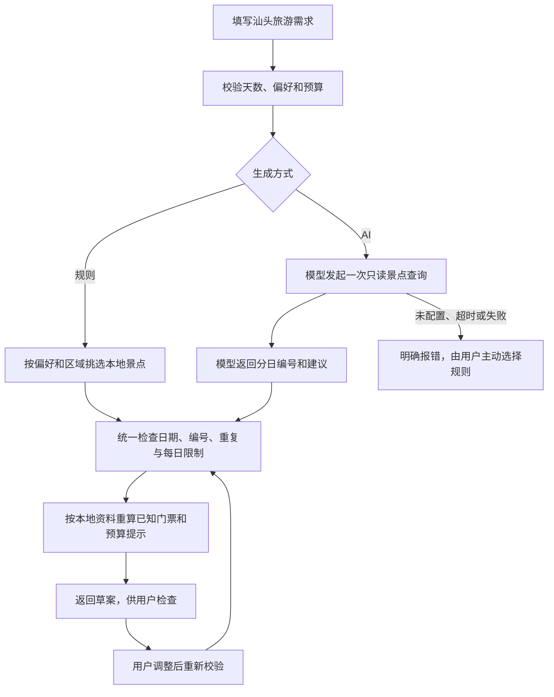

# 成员一：行程生成基础框架

## 本次范围与现有代码

按本地《智能旅游行程规划与管理系统_项目方案.md》第七节，成员一主要承担需求、AI 规划助手及行程生成。本次只接通“需求 → 候选 → 校验 → 草案”，不实现完整网站或保存管理。

仓库 A/B 是代码模块分工，不能直接与原方案成员一/二等同。本次复用队友 `feat/b-planning` 的后端、景点、Agent 与规划组件；保留其原提交作者，新增成员一所需的规则与统一校验服务。公共模型沿用队友最新版的未知票价、每日说明与区域字段，不重写第二套 Agent 或资料服务。

当前可运行：健康检查、景点查询、规则生成、Agent 生成入口、草案校验。真实模型调用仍需本地配置并验证。前端只有队友的规划组件，没有整站工程；保存、历史、删除尚未实现，对应接口返回 404。实验一报告保留为当时的文档初稿，不据此补写原型实操结果。

## 最小结构

```text
backend/app/
  main.py                  FastAPI 入口、错误处理与路由注册（复用）
  contracts.py             公共需求、候选与草案模型（复用）
  config.py                本地配置（复用）
  catalog/                 只读景点服务（复用）
  planning/agent.py        一个 Agent、一个只读工具（复用）
  planning/service.py      选择规则或 Agent，然后统一校验（复用）
  itineraries/rules.py     新增：确定性规则候选
  itineraries/service.py   新增：编号、天数、重复、区域校验与费用重算
  itineraries/router.py    新增：草案校验接口，不保存
```

## 生成流程



Agent 最多两次模型调用、一次工具执行；不自动重试或静默回退，不写文件。只有真实观察到模型调用工具才可描述为真实 Agent 演示；离线替身测试不作该声明。方案接口依据 [LangChain 官方文档](https://docs.langchain.com/oss/python/langchain/agents)，接口测试采用 [FastAPI TestClient](https://fastapi.tiangolo.com/tutorial/testing/)。

## 启动与尝试

安装 Python 3.13 和 uv 后，在仓库根目录执行：

```powershell
cd backend
uv sync --locked
uv run --locked uvicorn app.main:app --host 127.0.0.1 --port 8000
```

打开 `http://127.0.0.1:8000/docs`，在 `POST /api/plans/generate` 点击 Try it out，输入：

```json
{"city":"汕头","day_count":2,"preferences":["自然"],"budget_cny":100,"mode":"rules"}
```

规则模式无需配置模型。返回 `status="draft"` 的分日草案，不保存数据。未知票价以 `has_unknown_prices=true` 提醒；已知费用未超预算但含未知价格时，`over_budget=null`，不能当成免费或预算满足。`POST /api/plans/validate` 可按 [接口契约](api.md) 提交调整后的分日 ID，费用由服务端重新计算。

如需真实 AI，在本地将 `backend/.env.example` 复制为 `.env`，自行填写 `LLM_MODEL`、`LLM_API_KEY`，服务需要时填写 `LLM_BASE_URL`；重启后把请求的 `mode` 改为 `agent`。本次不读取或提交真实凭据，未执行真实模型联调。服务不支持工具调用或配置缺失时会明确失败，用户可另发规则请求。

## 检查与后续

在 `backend` 目录执行 `uv run --locked pytest -q` 和 `uv run --locked ruff check app tests`。关键检查覆盖规则确定性、未知价格、非法编号/日期/重复/区域、Agent 候选共用校验及已有 Agent 调用限制。测试使用独立资料、临时目录和替身模型，不消耗模型配额。

2026-11-06 实测：使用 `uv sync --locked` 安装现有锁文件，Python 3.13.18；后端 `pytest -q` 共 43 项通过，`ruff check app tests` 与 `ruff format --check app tests` 通过。启动临时本机 Uvicorn 服务，通过真实 HTTP 检查健康接口、规则生成、草案重新校验及 Swagger 页面；未配置模型时 Agent 明确返回 503 `AGENT_UNAVAILABLE`。这次未执行真实模型调用或完整前端构建。

后续按需要接入 Vue 主工程、草案编辑与确认保存；本次不展开数据库、账户、地图、更多工具、RAG 或多 Agent。真实 Agent 的工具调用记录留待具备可用模型服务时验证。

## 本轮基础工作流补齐（2026-11-06）

本轮以“需求 → 候选 → 统一校验 → 草案”为交付边界，不把“一半左右”换算为没有依据的完成百分比。沿用已有单 Agent，实现可调试、可检查的基础链路；前端、持久化、其他模块、额外工具与资产批处理均不展开。HTTP 请求与响应字段不变。

`app/planning/service.py` 负责固定顺序的工作流，`agent.py` 内部负责模型/工具循环，A 的 `itineraries/service.py` 负责最终业务校验。前者新增 `check_request → generate_candidate → validate_draft → draft_ready` 阶段日志；每次生成有独立 `run_id`，失败记录阶段和错误码，不记录需求正文、模型回复、密钥或原始异常。日志表示执行阶段，不是模型的隐藏思考过程；HTTP 请求解析失败时尚未进入这些阶段。

新增本地入口，与 HTTP 使用同一服务。在 `backend` 下执行：

```powershell
uv run --locked python -m app.planning --mode rules --days 2 --budget 100 --preference 自然
```

终端标准错误显示阶段，标准输出显示草案 JSON；入口不保存文件。默认 `rules` 不初始化模型。天数/预算非法或服务失败时退出码为 1。显式选择 `--mode agent` 才使用本地模型配置并可能消耗配额；失败不会回退为规则。

已配置可用模型后，手动尝试：

```powershell
uv run --locked python -m app.planning --mode agent --days 2 --budget 100 --preference 人文
```

理解代码可按 `contracts.py → catalog/service.py → planning/agent.py → planning/service.py → itineraries/service.py` 阅读。`@tool` 将有明确参数和描述的 Python 函数暴露给模型；模型提出调用请求，LangChain 执行本地函数并把结果交回模型。提示词说明规则，程序检查规则；两者缺一不可。

本轮检查：后端 47 项测试通过，新增真实框架循环到 A 校验及调整重校验的离线贯穿测试、非法候选停止测试、命令行规则与错误退出检查。框架与本地工具确实执行，模型用测试替身，不能描述为真实模型质量验收。真实服务的工具调用兼容性、推荐质量、延迟与费用仍待具备凭据时验证。
